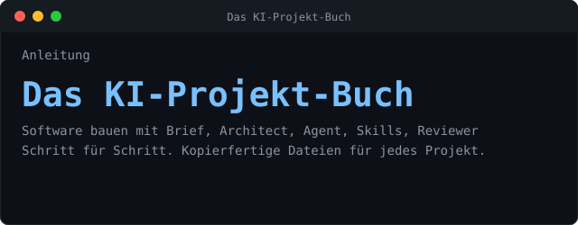

<p align="center"></p>

<p align="center">
<b>Brief → Architect → Agent → Reviewer</b>, dazu <b>Skills</b> und eine kurze <b>AGENTS.md</b>.<br>
Alles zum Kopieren. Für jedes Projekt.
</p>

## `$ ./ablauf`

<p align="center"></p>

## `$ quickstart`

```console
# alles laden
$ curl -fsSL https://raw.githubusercontent.com/atshv/Projekt-Buch-/main/install.sh | bash -s mein-projekt

# nur einzelne Dateien laden (im aktuellen Ordner)
$ curl -fsSL https://raw.githubusercontent.com/atshv/Projekt-Buch-/main/install.sh | bash -s -- \
    --datei AGENTS.md --datei roles/architect.md --datei roles/agent.md

# alle ladbaren Dateien anzeigen
$ curl -fsSL https://raw.githubusercontent.com/atshv/Projekt-Buch-/main/install.sh | bash -s -- --liste
```

Danach:

```console
$ cd mein-projekt && git init
$ $EDITOR AGENTS.md        # Abschnitt 1 + 4 ausfüllen
```

Ordner im KI-Programm öffnen, **Prompt 1** aus `START-PROMPTS.md` einfügen. Fertig.

Ohne Skript: `git clone https://github.com/atshv/Projekt-Buch-.git` und den Ordner `projekt-starter/` kopieren.

## `$ tree`

<p align="center"></p>

## `$ cat ROLLEN`

| Rolle | Datei | Schreibt |
|:--|:--|:--|
| `brief-creator` | `roles/brief-creator.md` | `docs/BRIEF.md` |
| `architect` | `roles/architect.md` | ARCHITECTURE, PLAN, DECISIONS |
| `agent` | `roles/agent.md` | Code, Tests, HANDOFF, PROGRESS |
| `reviewer` | `roles/reviewer.md` | `docs/REVIEW.md` (kein Code) |
| `skill-creator` | `skills/skill-creator/SKILL.md` | neue Skills |

## `$ validate_skill.py`

```console
$ python3 projekt-starter/skills/skill-creator/scripts/validate_skill.py \
          projekt-starter/skills/mein-skill
Ergebnis: 0 Fehler, 0 Hinweise (38 Zeilen Körper)
```

## `$ cat GRUNDSAETZE`

<p align="center"></p>

## `$ open buch`

Das ganze Buch als Webseite, mit Kopieren-Knopf an jeder Datei:

**[docs/index.html](https://htmlpreview.github.io/?https://github.com/atshv/Projekt-Buch-/blob/main/docs/index.html)**

```console
Teil A  Verstehen            Überblick, Prompt vs. Skill vs. Brief, Einrichten
Teil B  Schritt für Schritt  Brief, AGENTS.md, Architect, Skills, Agent, Reviewer, Betrieb
Teil C  Kopier-Set           jede Datei vollständig
```
