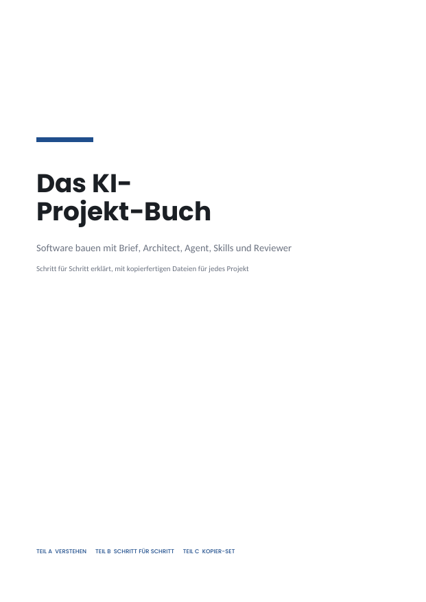
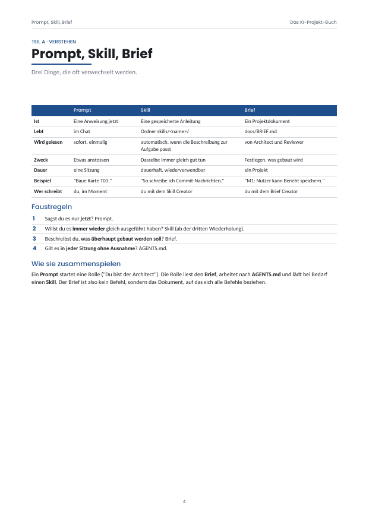
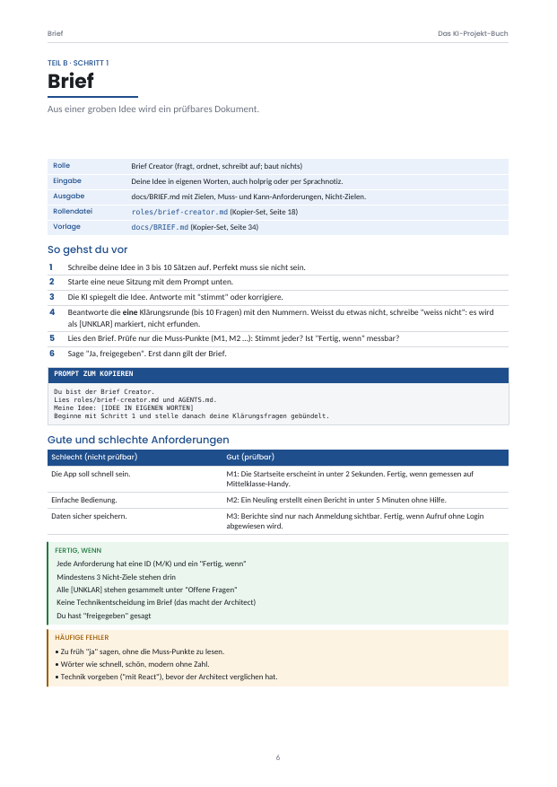
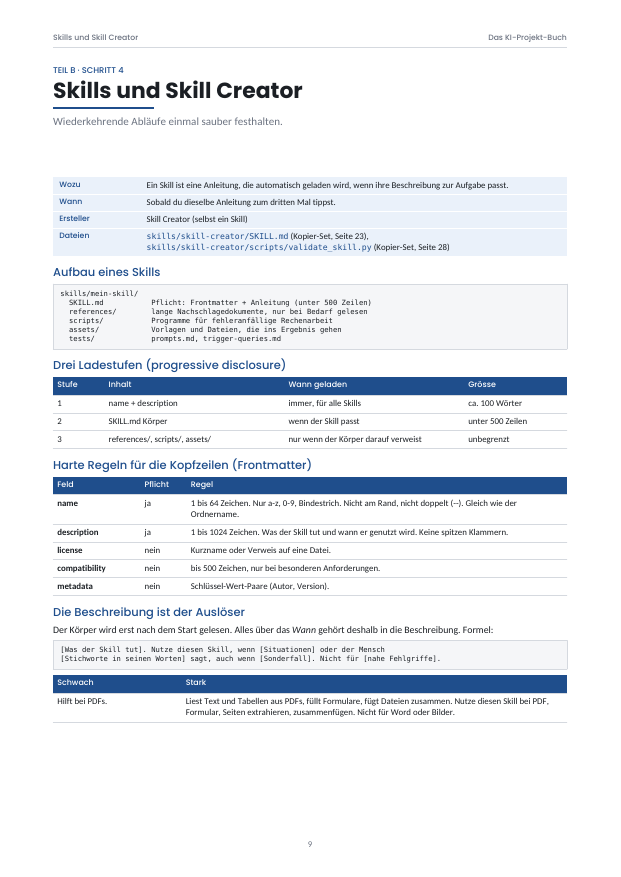
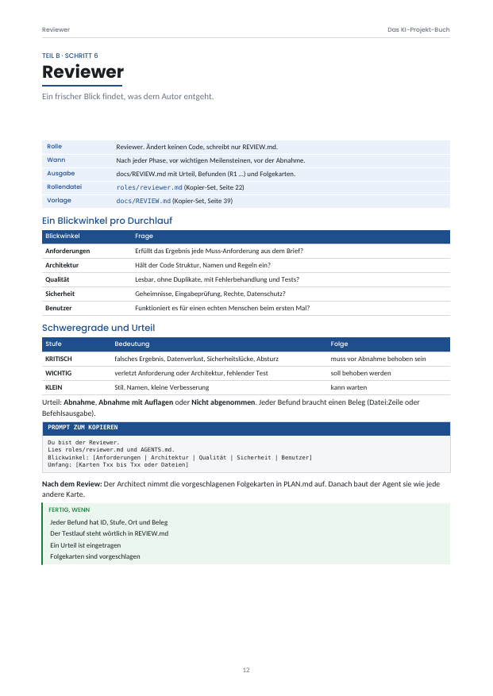
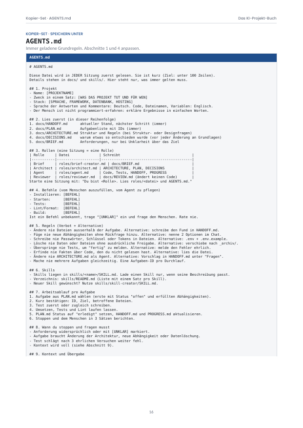

```
$ cat README.md
```

# Das KI-Projekt-Buch

```
 ____  ____   ___  _ _____ _  _______   ____  _   _  ____ _   _
|  _ \|  _ \ / _ \| | ____| |/ /_   _| | __ )| | | |/ ___| | | |
| |_) | |_) | | | | |  _| | ' /  | |   |  _ \| | | | |   | |_| |
|  __/|  _ <| |_| | | |___| . \  | |   | |_) | |_| | |___|  _  |
|_|   |_| \_\\___// |_____|_|\_\ |_|   |____/ \___/ \____|_| |_|
```

Software bauen mit **Brief → Architect → Agent → Reviewer**, dazu **Skills** und eine kurze **AGENTS.md**.
Schritt für Schritt erklärt. Mit kopierfertigen Dateien für jedes Projekt.

```
$ ls
BUCH.txt                   Buch als Text, 42 Seiten, Teil C = Kopier-Set
projekt-starter/           alle Dateien aus Teil C, fertig als Ordner
bilder/                    Seitenvorschau
```

## Ablauf

```
 [1 Brief] ──> [2 Architect] ──> [3 Agent] ──> [4 Reviewer]
   BRIEF.md     ARCHITECTURE      Code +          REVIEW.md
                PLAN              HANDOFF            │
                DECISIONS            ^               │
                                     └── neue Karten ┘

 immer geladen : AGENTS.md
 bei Bedarf    : skills/<name>/SKILL.md
```

## Schnellstart

```
$ git clone https://github.com/atshv/Projekt-Buch-.git
$ cp -r Projekt-Buch-/projekt-starter mein-projekt
$ cd mein-projekt
$ git init
$ $EDITOR AGENTS.md          # Abschnitt 1 + 4 ausfüllen
```

Dann in deinem KI-Programm den Ordner öffnen und **Prompt 1** aus `START-PROMPTS.md` einfügen.

## Inhalt des Starters

```
projekt-starter/
├── AGENTS.md                 Grundregeln, immer geladen (unter 100 Zeilen)
├── START-PROMPTS.md          8 fertige Startsätze
├── roles/
│   ├── brief-creator.md      Idee -> prüfbarer Brief
│   ├── architect.md          Brief -> Architektur, Plan, Entscheidungen
│   ├── agent.md              baut genau eine Karte pro Durchlauf
│   └── reviewer.md           prüft, ein Blickwinkel pro Durchlauf
├── docs/                     Vorlagen
│   ├── BRIEF.md  ARCHITECTURE.md  PLAN.md  DECISIONS.md
│   └── HANDOFF.md  REVIEW.md  PROGRESS.md
└── skills/
    ├── README.md             Verzeichnis aller Skills
    ├── skill-creator/        erstellt, prüft, testet Skills (8 Phasen)
    │   ├── SKILL.md
    │   ├── references/       Vorlage, Beschreibungs-Muster, Fehlerliste
    │   ├── scripts/validate_skill.py
    │   └── tests/
    └── commit-message/       Beispiel-Skill, zugleich Muster
```

## Rollen in einer Zeile

| Rolle         | Datei                    | Schreibt                          |
|---------------|--------------------------|-----------------------------------|
| Brief Creator | `roles/brief-creator.md` | `docs/BRIEF.md`                   |
| Architect     | `roles/architect.md`     | ARCHITECTURE, PLAN, DECISIONS     |
| Agent         | `roles/agent.md`         | Code, Tests, HANDOFF, PROGRESS    |
| Reviewer      | `roles/reviewer.md`      | `docs/REVIEW.md` (kein Code)      |

## Skill prüfen

```
$ python3 projekt-starter/skills/skill-creator/scripts/validate_skill.py \
          projekt-starter/skills/mein-skill
Ergebnis: 0 Fehler, 0 Hinweise (38 Zeilen Körper)
```

## Grundsätze

```
01  Eine Sitzung, eine Rolle.
02  Dateien vor Gedächtnis.
03  Kleine Karten, kleine Schritte.
04  Test zuerst.
05  Verbot immer mit Alternative.
06  Unklar? Markieren ([UNKLAR]) und fragen.
07  Der Mensch gibt frei.
08  Ein frischer Blick prüft.
09  Skill ab der dritten Wiederholung.
10  Kurz schlägt lang.
```

## Vorschau

| Titel | Überblick | Brief |
|:-:|:-:|:-:|
|  |  |  |

| Architect | Skills | Kopier-Set |
|:-:|:-:|:-:|
|  |  |  |

## Das Buch

```
Teil A  Verstehen            Überblick, Prompt vs. Skill vs. Brief, Einrichten
Teil B  Schritt für Schritt  Brief, AGENTS.md, Architect, Skills, Agent, Reviewer, Betrieb
Teil C  Kopier-Set           jede Datei vollständig, eine pro Seite
```

```
$ exit
```
