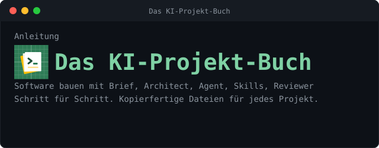
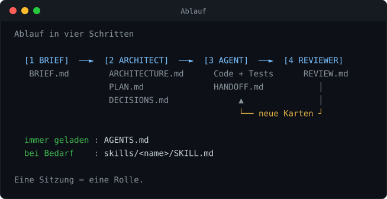
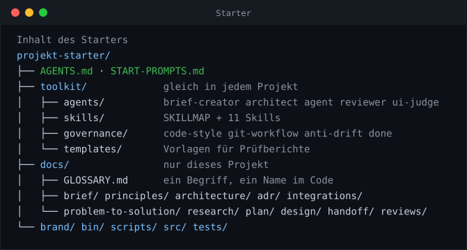
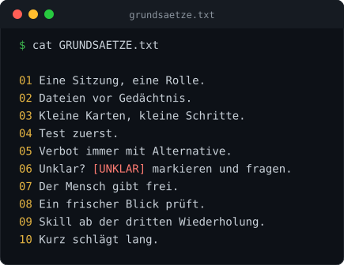

<p align="center"></p>

<p align="center">
<b>Brief → Architect → Agent → Reviewer</b>, dazu <b>Skills</b> und eine kurze <b>AGENTS.md</b>.<br>
Alles zum Kopieren. Für jedes Projekt.
</p>

##  Ablauf

<p align="center"></p>

##  Schnellstart

```console
# Alles laden
curl -fsSL https://raw.githubusercontent.com/atshv/Projekt-Buch-/main/install.sh | bash -s mein-projekt

# Nur einzelne Dateien laden (in den aktuellen Ordner)
curl -fsSL https://raw.githubusercontent.com/atshv/Projekt-Buch-/main/install.sh | bash -s -- \
    --datei AGENTS.md --datei toolkit/agents/architect.md --datei toolkit/agents/agent.md

# Alle ladbaren Dateien anzeigen
curl -fsSL https://raw.githubusercontent.com/atshv/Projekt-Buch-/main/install.sh | bash -s -- --liste
```

Danach im Projektordner:

```console
cd mein-projekt && git init
# Datei AGENTS.md öffnen, Abschnitt 1 ausfüllen
```

Ordner im KI-Programm öffnen, **Prompt 1** aus `START-PROMPTS.md` einfügen. Oder **Prompt 16**:
Er führt in einer Sitzung von der Idee über Brief, Architektur und Plan bis zur Einrichtung. Fertig.

Ohne Skript: `git clone https://github.com/atshv/Projekt-Buch-.git` und den Ordner `projekt-starter/` kopieren.

##  Dateien

<p align="center"></p>

##  Rollen

| Rolle | Datei | Schreibt |
|:--|:--|:--|
| `brief-creator` | `toolkit/agents/brief-creator.md` | `docs/BRIEF.md` |
| `architect` | `toolkit/agents/architect.md` | ARCHITECTURE, PLAN, DECISIONS |
| `agent` | `toolkit/agents/agent.md` | Code, Tests, HANDOFF, PROGRESS |
| `reviewer` | `toolkit/agents/reviewer.md` | `docs/REVIEW.md` (kein Code) |
| `ui-judge` | `toolkit/agents/ui-judge.md` | `docs/UI-REVIEW.md` (prüft Oberfläche gegen Prototyp) |
| `skill-creator` | `toolkit/skills/skill-creator/SKILL.md` | neue Skills |

### Skills

Alle Skills haben dasselbe Gerüst: Kurzstart, Benötigte Eingaben, Ablauf, Ausgabe (Ort und Dateiname), Qualitätstor, Verwandte Skills, Nicht tun.

| Skill | Wofür | Ergebnis |
|:--|:--|:--|
| `plan-challenge` | Plan oder Brief löchern, eine Frage nach der anderen | geklärte Punkte |
| `principle-writer` | prüfbare Grundsätze festlegen | `docs/principles/PRINCIPLES.md` |
| `glossary-keeper` | ein Begriff, ein Name im Code | `docs/GLOSSARY.md` |
| `prior-art-research` | was gibt es schon? (arXiv, GitHub) | `docs/research/<thema>/` |
| `decision-brief` | Optionen fair vergleichen | `docs/problem-to-solution/` |
| `adr-writer` | Entscheidungen festhalten (mit Skript) | `docs/adr/adr-0001-….md` |
| `plan-cards` | Aufgabenkarten schneiden | `docs/plan/PLAN.md` |
| `commit-message` | Commit-Nachrichten „T07: …“ | Nachricht |
| `pb-writer` | README, CONTRIBUTING, Doku | `README.md`, `docs/` |
| `plain-language` | Lesbarkeit messen (mit Skript) | Lesewert + Vorschläge |
| `skill-creator` | neue Skills bauen und prüfen | `toolkit/skills/<name>/` |

Welcher Skill wann passt: `toolkit/skills/SKILLMAP.md`.

##  Skill anlegen und prüfen

```console
bin/new-skill bericht-schreiben    # Gerüst anlegen
bin/check-skills                   # alle Skills prüfen, Abgleich mit SKILLMAP.md
```

##  Beim Bauen prüfen

```console
bin/check-plan                     # Plan vollständig? Abnahme, Abhängigkeiten, Umfang der Architektur
bin/check-scope T05                # nur Dateien der Karte T05 geändert? Geschützte Pfade unberührt?
bin/record-test T05 -p A1,A2 -- npm test   # Testlauf als Nachweis ablegen (Arbeitsstand + Prüfsumme)
bin/check-done T05                 # jede Abnahme belegt? Test zuerst eingehalten?
bin/new-change pdf-export          # Änderung an einem laufenden Projekt anlegen
bin/finish-change pdf-export       # Änderung abschliessen und archivieren
```

##  Welches KI-Programm liest was

Die Regeln stehen nur in `AGENTS.md`. Kleine Zeigerdateien verweisen darauf, damit jedes Programm sie findet.

| KI-Programm         | Liest                                | Datei im Starter                  |
|---------------------|--------------------------------------|-----------------------------------|
| Claude Code         | `CLAUDE.md`                          | `CLAUDE.md` (verweist auf AGENTS.md) |
| Gemini CLI          | `GEMINI.md`                          | `GEMINI.md` (verweist auf AGENTS.md) |
| Cursor              | `.cursor/rules/`                     | `.cursor/rules/projekt.mdc`       |
| GitHub Copilot      | `.github/copilot-instructions.md`    | `.github/copilot-instructions.md` |
| Codex und andere    | `AGENTS.md`                          | `AGENTS.md`                       |

Kein Plugin, keine Installation. Liest dein Programm keine davon, sag ihm im ersten Satz: "Lies AGENTS.md."

##  Grundsätze

<p align="center"></p>

##  Das Buch

Das ganze Buch als Webseite, mit Kopieren-Knopf an jeder Datei:

**[Buch online öffnen](https://raw.githack.com/atshv/Projekt-Buch-/main/docs/index.html)**  
Falls der Link nicht lädt: [Ersatz-Link](https://htmlpreview.github.io/?https://github.com/atshv/Projekt-Buch-/blob/main/docs/index.html)

```console
Teil A  Verstehen            Überblick, Prompt vs. Skill vs. Brief, Einrichten, Alles in einem Durchlauf
Teil B  Schritt für Schritt  Brief, AGENTS.md, Architect, Skills, Agent, Reviewer, Betrieb
Teil C  Kopier-Set           jede Datei vollständig
```
