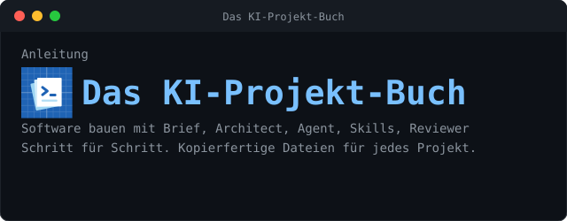
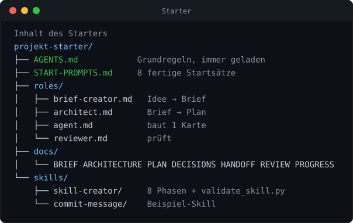

<p align="center"></p>

<p align="center">
<b>Brief → Architect → Agent → Reviewer</b>, dazu <b>Skills</b> und eine kurze <b>AGENTS.md</b>.<br>
Alles zum Kopieren. Für jedes Projekt.
</p>

##  Ablauf

<p align="center"></p>

##  Schnellstart

```console
# Alles laden
curl -fsSL https://raw.githubusercontent.com/atshv/Projekt-Buch-/main/install.sh | bash -s mein-projekt

# Nur einzelne Dateien laden (in den aktuellen Ordner)
curl -fsSL https://raw.githubusercontent.com/atshv/Projekt-Buch-/main/install.sh | bash -s -- \
    --datei AGENTS.md --datei agents/architect.md --datei agents/agent.md

# Alle ladbaren Dateien anzeigen
curl -fsSL https://raw.githubusercontent.com/atshv/Projekt-Buch-/main/install.sh | bash -s -- --liste
```

Danach im Projektordner:

```console
cd mein-projekt && git init
# Datei AGENTS.md öffnen, Abschnitt 1 ausfüllen
```

Ordner im KI-Programm öffnen, **Prompt 1** aus `START-PROMPTS.md` einfügen. Fertig.

Ohne Skript: `git clone https://github.com/atshv/Projekt-Buch-.git` und den Ordner `projekt-starter/` kopieren.

##  Dateien

<p align="center"></p>

##  Rollen

| Rolle | Datei | Schreibt |
|:--|:--|:--|
| `brief-creator` | `agents/brief-creator.md` | `docs/BRIEF.md` |
| `architect` | `agents/architect.md` | ARCHITECTURE, PLAN, DECISIONS |
| `agent` | `agents/agent.md` | Code, Tests, HANDOFF, PROGRESS |
| `reviewer` | `agents/reviewer.md` | `docs/REVIEW.md` (kein Code) |
| `ui-judge` | `agents/ui-judge.md` | `docs/UI-REVIEW.md` (prüft Oberfläche gegen Prototyp) |
| `skill-creator` | `skills/skill-creator/SKILL.md` | neue Skills |

### Skills

| Skill | Wofür | Referenzen |
|:--|:--|:--|
| `skill-creator` | Skills bauen, prüfen, testen | Vorlage, Beschreibungs-Muster, Fehlerliste |
| `pb-writer` | README, CONTRIBUTING, Doku | readme-writer, contributing-writer, documentation-writer |
| `prior-art-research` | Was gibt es schon? (arXiv, GitHub) | Suchstrategie, Berichtsvorlage |
| `commit-message` | Commit-Nachrichten | Muster für eigene Skills |

Welcher Skill wann passt: `skills/SKILLMAP.md`.

##  Skill anlegen und prüfen

```console
bin/new-skill bericht-schreiben    # Gerüst anlegen
bin/check-skills                   # alle Skills prüfen, Abgleich mit SKILLMAP.md
```

##  Grundsätze

<p align="center"></p>

##  Das Buch

Das ganze Buch als Webseite, mit Kopieren-Knopf an jeder Datei:

**[Buch online öffnen](https://raw.githack.com/atshv/Projekt-Buch-/main/docs/index.html)**  
Falls der Link nicht lädt: [Ersatz-Link](https://htmlpreview.github.io/?https://github.com/atshv/Projekt-Buch-/blob/main/docs/index.html)

```console
Teil A  Verstehen            Überblick, Prompt vs. Skill vs. Brief, Einrichten
Teil B  Schritt für Schritt  Brief, AGENTS.md, Architect, Skills, Agent, Reviewer, Betrieb
Teil C  Kopier-Set           jede Datei vollständig
```
